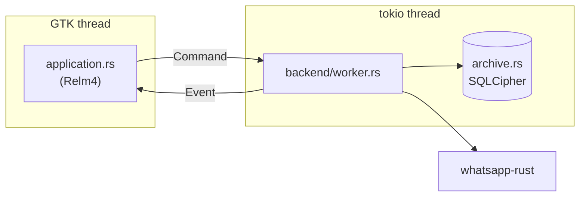

# ZapTide architecture

How the code is laid out and how the pieces talk to each other. The rules for contributors and agents (privacy, boundaries,
definition of done) are in [AGENTS.md](AGENTS.md); packaging and releases are in
[PACKAGING.md](PACKAGING.md). Day-to-day commands are in the [justfile](justfile).

## Overview

ZapTide is a GTK 4 / libadwaita WhatsApp client written in Rust. The protocol comes from
[whatsapp-rust](https://github.com/oxidezap/whatsapp-rust); the interface is built with Relm4.

The interface and the protocol run on separate threads and only exchange messages:



Several accounts can run at once. The window always shows the active account; the others are kept
in `application/accounts.rs` and updated from their own backend.

## Layout

| Path | What lives there |
| --- | --- |
| `src/application.rs`, `src/application/` | The Relm4 root component and its pieces: sidebar, transcript, composer, dialogs, account switcher, profile dialog. |
| `src/application/{icons,motion,bubbles,actions,helpers}.rs` | Pieces split out of `application.rs`: drawn and installed icons, scroll and fade animations, message bubble widgets, window actions, small pure helpers. |
| `src/backend.rs`, `src/backend/` | The `Command` and `Event` types and the worker that owns the connection. |
| `src/archive.rs`, `src/archive/` | The encrypted SQLite store of chats, messages and contacts. |
| `src/model/` | The app's own types. Views never see a protobuf. |
| `src/native_*.rs` | Toolkit-facing helpers: notifications, tray, portals, media widgets, preferences, theme. |
| `src/account.rs`, `src/paths.rs`, `src/settings.rs` | Account registry, per-account folders, saved settings. |
| `data/` | Everything that is not code: `style.css`, `theme-defaults.css`, the desktop file, icons. |
| `assets/themes/` | Bundled colour themes. |
| `packaging/` | Flatpak and AppImage build files. |
| `po/` | Translations. |
| `tests/` | Integration tests. |

## Styling

Static CSS is in `data/style.css` and `data/theme-defaults.css` and is embedded at build time by
`apply_theme` in `src/application.rs`. Only the palette of a custom theme and the zoom are generated
at run time. Add new rules to `data/style.css` rather than to the Rust code.

## Translations

UI strings go through `gettext("...")` from `src/i18n.rs`. `just pot` refreshes `po/zaptide.pot` and
merges it into each language listed in `po/LINGUAS`; `just run` compiles the catalogues into
`target/locale` first. The Flatpak manifests install the compiled catalogues under `/app/share/locale`.
Brazilian Portuguese is the first translation. Strings built with `format!` and the AppImage build are
not translated yet.

## Building

```sh
just check   # fmt, clippy, tests
just run
```

Build inside a toolbox that has the GTK 4 and libadwaita development files; see
[AGENTS.md](AGENTS.md) for the platform dependencies.
