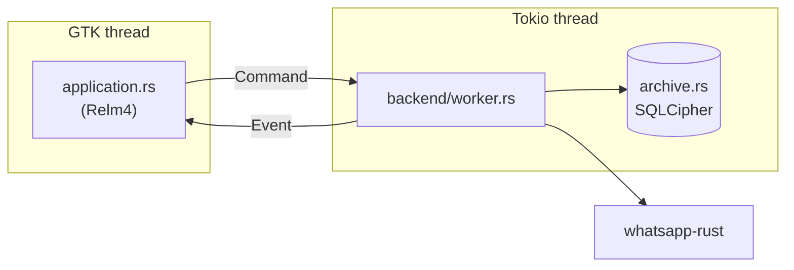

# ZapTide architecture

ZapTide uses Rust, GTK4, libadwaita and Relm4. The WhatsApp protocol comes from
[whatsapp-rust](https://github.com/oxidezap/whatsapp-rust).
[AGENTS.md](AGENTS.md) sets agent policy;
[architecture contracts](docs/architecture-contracts.md) record the invariants
to preserve when changing a subsystem. Build and distribution details belong
in [PACKAGING.md](PACKAGING.md).

## Threads and ownership

The interface and protocol run on separate threads:

Widgets send `Input`s to Relm4's `update`. The worker owns the connection,
archive, downloads and profile pictures; each emitted event wakes the window
through `Waker`. The window shows one account while `application/accounts.rs`
keeps inactive accounts updated through their own backends.

The worker converts protobufs into model types in `classify()` and
`parse_conversation()`. Views never handle protobufs. Chat IDs are canonical
strings: known privacy IDs (`@lid`) resolve to phone-number IDs.

## Layout

| Path | Responsibility |
| --- | --- |
| `src/application.rs`, `src/application/` | Relm4 root, sidebar, transcript, composer, dialogs and accounts. `dispatch.rs` handles focused input; the root keeps the update entry point. |
| `src/backend.rs`, `src/backend/worker.rs` | Commands, events, shared worker state, batch invariants and orchestration. |
| `src/backend/worker/` | History, identity, downloads, outbound sends, calls and maintenance operations. |
| `src/archive.rs`, `src/archive/` | Encrypted SQLite archive, contacts, privacy-ID mappings, polls and receipts. |
| `src/model/` | Application types; `call.rs` contains the call state machine. |
| `src/native_media_widgets/`, `src/native_transcript.rs` | Message/media widgets and cross-message selection and copying. Viewer modules live in `native_media_widgets/viewer/`. |
| `src/calls/`, `src/voice.rs`, `src/audio.rs`, `src/services/media.rs` | Call devices, ringing, voice-note codec, waveform decoding and playback. |
| `src/native_*.rs` | GTK-facing integrations, including notifications, tray, portals, preferences and themes. |
| `src/portal.rs` | Shared Tokio runtime for ashpd calls; its session bus connection lives as long as the runtime. |
| `src/account.rs`, `src/paths.rs`, `src/settings.rs` | Account registry, data paths and saved settings. |
| `src/shared_resource.rs` | Independent resource counters and RAII permits with poisoned-mutex recovery. |
| `data/`, `assets/`, `po/` | CSS, desktop integration, icons, bundled themes/sounds and translations. |
| `packaging/`, `tests/` | Distribution build files and integration tests. |

## Themes and translations

`apply_theme` embeds `data/style.css` and `data/theme-defaults.css`.
`src/native_theme.rs` maps a palette to GTK CSS; only custom palettes and zoom
need runtime-generated values. Local JSON themes are scanned off the UI
thread, cached in settings and reloaded by filesystem notifications. Bundled
defaults share Spotifast palettes. `reload-themes` uses the single-instance
channel without opening a window.

UI strings use gettext through `src/i18n.rs`. `just pot` refreshes
`po/zaptide.pot` and merges languages in `po/LINGUAS`; `just run` compiles them
into `target/locale`. Flatpak installs catalogues under `/app/share/locale`.
Brazilian Portuguese is the first translation. Strings built with `format!`
and the AppImage build are not translated yet.

## Building

Use the pinned Rust toolchain with the native dependencies in
[PACKAGING.md](PACKAGING.md#build-dependencies). `just check` runs fmt, Clippy
and tests; rustdoc is a separate check. See
[CONTRIBUTING.md](CONTRIBUTING.md#verify-your-change) for the full validation
procedure. `just run` compiles translations and launches the app.
