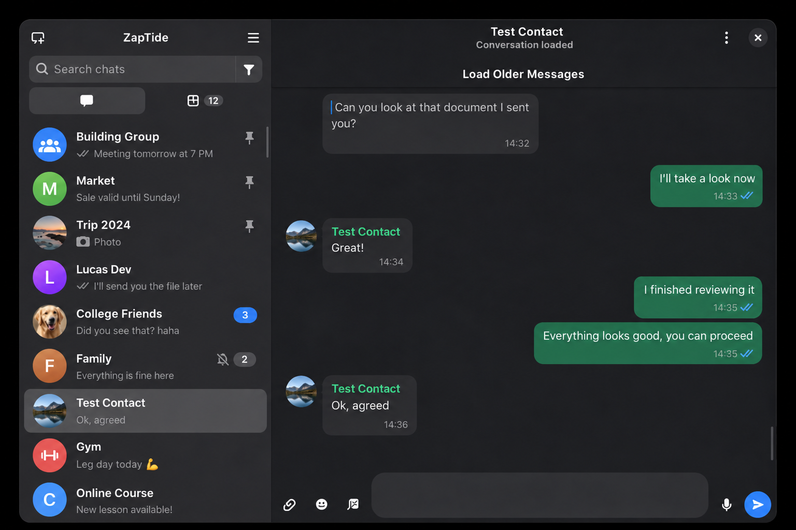

<div align="center">


# ZapTide

A native WhatsApp companion for Linux, built with Rust, GTK4 and libadwaita.

[Download](https://github.com/luminusOS/zaptide/releases/latest) · [Features](#features) · [Install](#install) · [Report a bug](https://github.com/luminusOS/zaptide/issues)

</div>

ZapTide links to your phone through [whatsapp-rust](https://github.com/oxidezap/whatsapp-rust),
without a browser engine. Messages stay in a local, encrypted archive.



> [!WARNING]
> ZapTide is unofficial and is not affiliated with WhatsApp or Meta. Using an
> unofficial client may violate WhatsApp's terms and put your account at risk.

## Features

- Text, voice notes, polls, stickers and attachments.
- Voice and video calls with one contact, with a call history.
- Multiple accounts with separate history and settings.
- Chat search, starred messages and link previews.
- Desktop notifications and synced read status.
- Phone notifications while you do not use ZapTide: ZapTide goes offline soon
  after you leave it or stop using it (Preferences, Notifications).
- Light, dark and custom themes.

## Install

[Download a Flatpak or AppImage](https://github.com/luminusOS/zaptide/releases/latest)
for x86_64 or aarch64 (ARM64). Native distribution packages are not available yet.

### Flatpak

Configure [Flathub](https://flathub.org/setup), then install the bundle (replace the filename):

```sh
flatpak install --user ./zaptide-vX.Y.Z-x86_64.flatpak
flatpak run dev.luminusos.ZapTide
```

For a newer bundle, use `--reinstall`:

```sh
flatpak install --user --reinstall ./zaptide-vX.Y.Z-x86_64.flatpak
```

For a system installation, replace `--user` with `--system`.

### AppImage

Save the download as `zaptide.AppImage` and run it:

```sh
chmod +x ./zaptide.AppImage
./zaptide.AppImage
```

Update in place with [AppImageUpdate](https://github.com/AppImageCommunity/AppImageUpdate),
which downloads only changed blocks. Replace pre-0.7.2 AppImages manually once;
they lack update information.

After updating, quit from the menu and reopen. Closing the window can leave the
old version running.

## First steps

Scan the QR code from WhatsApp's **Linked devices**, or link with your phone number.
History may take a few minutes. The avatar adds or switches accounts;
**Remove Account…** unlinks one and deletes only its local data.

Enter sends; Shift+Enter adds a line (configurable). Emoji selection returns focus
to the input. Escape dismisses selection, edits or replies before closing the chat.
**Close Chat** also returns home; both keep drafts and mark nothing as read.

GIFs play silently while their rows are shown. Leaving the conversation or hiding
the window releases their playback resources; showing them again restarts playback.

## Calls

> [!WARNING]
> Calls are new and have only been tested without a real call: no voice or video
> call has been placed against a phone yet, so audio quality and video
> interoperability are unverified. Expect rough edges.

Open a direct chat and use the phone or camera button in its header to call.
Incoming calls open a call window and send a desktop notification (there is no
ringtone). Decline, answer, mute, and turn the camera on or off from that window.
Calls are listed under the Calls tab beside Chats and Archived, and each one also
appears in its chat as an event such as "Missed voice call". Calls placed from
your phone show up in the history after syncing.

Calls connect to WhatsApp's relay servers over UDP and use the default
microphone and speaker. Video needs a camera, an H.264 encoder (the GStreamer
`openh264` or `x264` plugin) and a decoder (`libav` or `openh264`). Without them
a voice call still works and a video call tells you what is missing.

- **Flatpak:** video calls are not supported yet. The sandbox has no camera
  access and no H.264 codec extension, so only voice calls can work.
- **AppImage:** the bundle carries an H.264 decoder, but whether it carries an
  encoder and the camera plugins has not been checked; voice calls are the
  supported path.
- Only one call runs at a time, group calls do not ring, and a call ends when
  the app quits.

## Your data

> [!IMPORTANT]
> Back up the archive with its OS keyring credential: `archive.db` alone cannot
> be decrypted. Unlock a locked keyring; restore a missing credential instead of
> replacing the key or deleting the archive.

Device credentials, downloads, saved stickers and settings are unencrypted; use
full-disk encryption for them and backups. Data and keyring entries are separate
from ZapFast, FastsApp and FastWhatsApp. Link ZapTide separately.

Previews contact websites directly while composing, without proxies or redirects.
Private/reserved destinations are blocked. Disable previews per account or remove one.

Stored chats remain available with a notice if phone settings cannot be read;
locked chats stay locked until those settings arrive.

## Limitations

- Group calls, status posts, communities and group administration are not supported.
  Newsletter channels are read-only.
- Messages with disappearing timers remain in the local archive after they
  expire on your phone.
- Keyboard shortcuts and screen-reader labels are available; accessibility is incomplete.

## Build from source

Install Rust through rustup and the dependencies in [PACKAGING.md](PACKAGING.md).
The toolchain is pinned. GTK 4.14+ and libadwaita 1.10+ are required; CI uses Fedora 45.

```sh
git clone https://github.com/luminusOS/zaptide.git
cd zaptide
cargo build --locked
```

See [CONTRIBUTING.md](CONTRIBUTING.md) for checks and running with translations,
and [ARCHITECTURE.md](ARCHITECTURE.md) for the code layout.
Report vulnerabilities privately through [SECURITY.md](SECURITY.md).

## About the project

ZapTide is a [LuminusOS](https://luminusos.org) hard fork of
[ZapFast](https://github.com/crmne/zapfast), with a Relm4 interface and multiple accounts.
Original code © Carmine Paolino; see [LICENSE](LICENSE).
